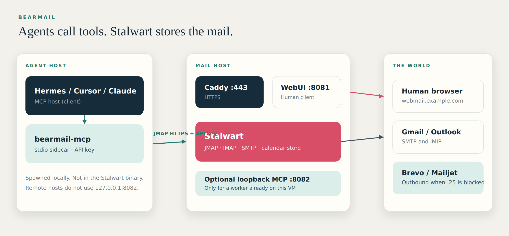
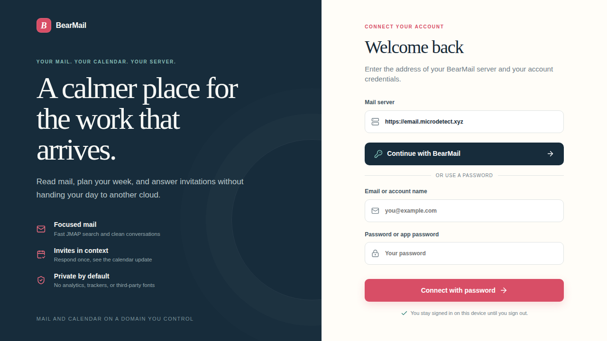
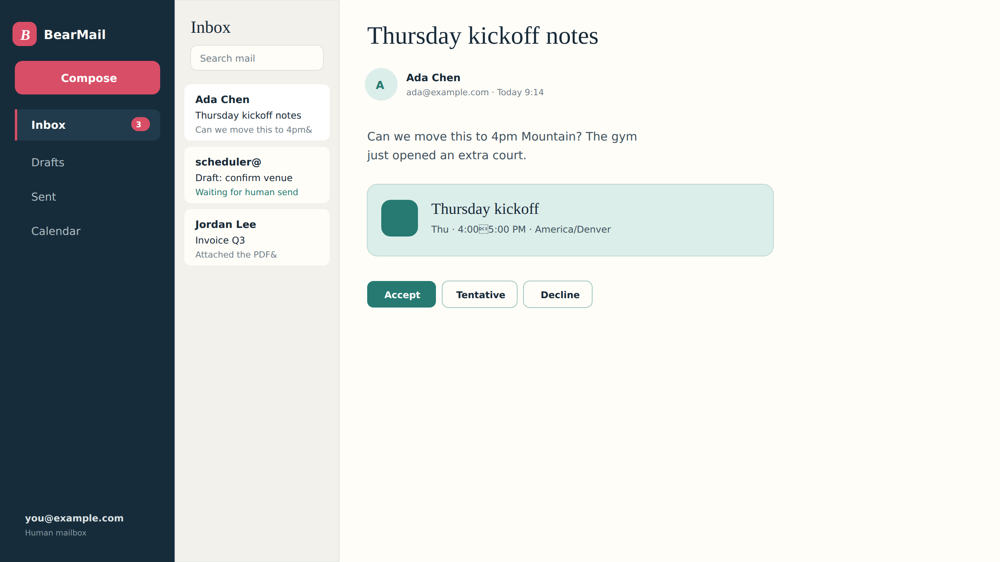
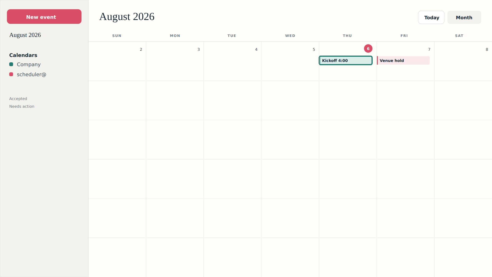

# BearMail

Give your team and AI agents a **real mailbox and calendar on the company
domain**. Self-hosted control. Ordinary email and calendar to the rest of
the world.

BearMail is one self-hosted mail and calendar system for people and AI
agents. The mail engine is a customized [Stalwart](https://stalw.art).
BearMail is the website people open. BearOS is the admin UI. Cursor,
Claude, and Hermes use the same mailboxes through MCP.

**Release:** [v0.1.0](https://github.com/luoxiprovo/bearmail/releases/tag/v0.1.0)
— Linux x86-64 binary, web archive, checksums.
**Agent handoff:** [docs/QUICKSTART.md](docs/QUICKSTART.md).
**Limits:** [docs/LIMITATIONS.md](docs/LIMITATIONS.md).

One Linux **x86-64** server with systemd. When the installer finishes you
have:

- mail on `mail.example.com` (SMTP, IMAP, JMAP, and BearOS);
- BearMail on `https://bearmail.example.com`;
- HTTPS via Caddy;
- outbound mail through Brevo when the VPS blocks TCP 25;
- DNS through **name.com**, **Hostinger**, or **GoDaddy** (other registrars
  are a manual zone).



Larger diagram: [docs/ARCHITECTURE.md](docs/ARCHITECTURE.md).

### Screenshots

| Connect | Mail | Calendar |
| --- | --- | --- |
| [](docs/img/screenshot-connect.png) | [](docs/img/screenshot-mail.png) | [](docs/img/screenshot-calendar.png) |

Connect, mail, and calendar are the same BearMail client.

This release is one host and one domain. It does not include managed
hosting, suite parity, Docker, Kubernetes, or ARM. Agents start
draft-only. See [docs/LIMITATIONS.md](docs/LIMITATIONS.md).

## Install

Prepare these before you start. The installer does not create the vendor
accounts.

- Linux **x86-64** with systemd, `sudo`, a public IPv4 address, and inbound
  TCP **80** and **443**.
- A domain on **name.com**, **Hostinger**, or **GoDaddy** nameservers, plus
  that provider's API token. Any other registrar means you publish the
  printed DNS rows yourself.
  [How the DNS step works](docs/INSTALL.md#6-publish-the-forward-dns-records).
- A [Brevo](https://app.brevo.com/) account for the mail domain: the SMTP
  login and the SMTP key from **Settings → SMTP & API → SMTP**. That key is
  separate from the Brevo website password.
  [Brevo SMTP relay](docs/BREVO_SMTP_RELAY.md).

From an SSH session on the server:

```sh
curl -fsSL https://raw.githubusercontent.com/luoxiprovo/bearmail/main/easy_install.sh | sudo bash
```

Preview the download plan without changing the system:

```sh
curl -fsSL https://raw.githubusercontent.com/luoxiprovo/bearmail/main/easy_install.sh | sh -s -- --dry-run
```

These choices are already made. The installer prints them and does not ask:

| Choice | Value |
| --- | --- |
| Layout | Standard system paths |
| Web files | `/opt/bearmail-webui` on port `8081` |
| HTTPS | Caddy, automatic |
| Outbound mail | Brevo at `smtp-relay.brevo.com:587` |
| DNS rows | Treated as not published yet, then sent to the provider you pick |

It asks for:

1. **BearMail portal URL.** The address people open in a browser. Type the
   domain; `https://` is added if you leave it off. Example:
   `bearmail.example.com`.
2. **Public mail hostname.** The admin and mail hostname. Example:
   `mail.example.com`.
3. **Primary mail domain.** The part after `@`. Example: `example.com` for
   `admin@example.com`.
4. **Apply this configuration.** Review the summary. Press Enter to accept.
5. **Brevo SMTP login** and **Brevo SMTP API key.**
6. **Domain name provider.** name.com, Hostinger, GoDaddy, or publish the
   printed rows by hand.
7. **DNS zone and API token** for that provider. The zone starts as the mail
   domain. If the portal domain is the parent of the mail domain, it starts
   as the portal domain. Example: portal `bearos.si` and mail domain
   `users.bearos.si` defaults the zone to `bearos.si`.
8. Whether to **replace conflicting DNS records** with the BearMail table.

When it finishes, the installer prints two things again. Save them:

- **BearMail portal for normal users**, for example
  `https://bearmail.example.com/`
- **Permanent administrator credential** (username and password). Use it at
  `https://mail.example.com/admin/` to add accounts. The password is not
  stored in `installer-state.json`.

Wait until DNS resolves, then open those URLs. The portal is BearMail. The
`/admin/` URL is the BearOS admin UI.

Mailjet, a custom layout, and every other prompt are in the
[full installer](docs/INSTALL.md).

## Give an agent a mailbox

1. Sign in to the BearOS admin UI and create a dedicated mailbox, such as
   `scheduler@example.com`. Leave `admin` and founder inboxes for people.
2. Sign in to BearMail as that mailbox. Open **Settings**, enter a name, and
   select **Generate API key**. Copy the `API_…` secret. It is shown once.
3. Paste this into the MCP host. Leave `draft-only` on until you opt in.
   Use the API key. A human password or an `app_…` app password will not
   authenticate the agent.

```json
{
  "mcpServers": {
    "bearmail": {
      "command": "node",
      "args": ["/opt/bearmail-mcp/dist/stdio.js"],
      "env": {
        "BEARMAIL_SERVER": "https://mail.example.com",
        "BEARMAIL_USERNAME": "scheduler@example.com",
        "BEARMAIL_TOKEN": "API_<stalwart-api-key>",
        "BEARMAIL_SEND_MODE": "draft-only"
      }
    }
  }
}
```

Guide: [How an AI agent uses BearMail](docs/AGENT_GUIDE.md).
Copy-paste configs: [`mcp/mcp.json.example`](mcp/mcp.json.example) (Cursor),
[`mcp/claude_desktop.json.example`](mcp/claude_desktop.json.example),
[`mcp/hermes.json.example`](mcp/hermes.json.example).
The prompt to send the agent is in [docs/QUICKSTART.md](docs/QUICKSTART.md).

## Already installed

Replace the mail binary, the BearOS admin UI, BearMail, and the MCP sidecar
from GitHub. This leaves `config.json`, Caddy, DNS, the SMTP relay, and
stored mail unchanged, and it does not ask setup questions:

```sh
curl -fsSL https://raw.githubusercontent.com/luoxiprovo/bearmail/main/upgrade.sh | sudo bash
```

Preview with `sudo bash -s -- --dry-run`. Use `upgrade.sh` for this update.
`install.sh` asks the setup questions again. The script refetches the BearOS
admin UI, then removes the one-shot admin it used for that call. After it
finishes, hard-refresh `/admin` and the BearMail portal.
Details: [Upgrade in place](docs/INSTALL.md#upgrade-in-place).

A host that already has mail and still needs the sidecar:

```sh
curl -fsSL https://raw.githubusercontent.com/luoxiprovo/bearmail/main/mcp_install.sh | sudo bash
```

If the mail origin cannot be detected, add
`--server-url https://mail.example.com`. Preview with
`sudo bash -s -- --dry-run`.

On a host with about 1 GB of RAM, after a successful install:

```sh
curl -fsSL https://raw.githubusercontent.com/luoxiprovo/bearmail/main/small-memory-optimize.sh | sudo bash
```

Details: [Small-memory VMs](docs/INSTALL.md#small-memory-vms).

## Uninstall

Stop the mail engine and BearMail, and remove their program files. Mail,
configuration, and logs stay in place. The script asks you to type
`UNINSTALL` before it changes the host:

```sh
curl -fsSL https://raw.githubusercontent.com/luoxiprovo/bearmail/main/uninstall.sh | sudo bash
```

Preview the detected paths without changing the host:

```sh
curl -fsSL https://raw.githubusercontent.com/luoxiprovo/bearmail/main/uninstall.sh | sh -s -- --dry-run
```

DNS records and the MCP sidecar stay. To delete stored mail as well, see
[Uninstall](docs/INSTALL.md#uninstall).

## Full wizard and source builds

`release_install.sh` downloads the same files and then asks every layout,
relay, and DNS question. Local files (`install.sh`, `stalwart`,
`bearmail-webui.tar.gz`) and the community source build are in
[How to install BearMail](docs/INSTALL.md#1-build-the-stalwart-artifact).

## Docs

| Doc | Use |
| --- | --- |
| [QUICKSTART.md](docs/QUICKSTART.md) | Install, create the agent key, paste the agent prompt |
| [LIMITATIONS.md](docs/LIMITATIONS.md) | Prerequisites, draft-only, caps, what this release leaves out |
| [ARCHITECTURE.md](docs/ARCHITECTURE.md) | Mail engine, BearMail, MCP, SMTP and calendar invites |
| [INSTALL.md](docs/INSTALL.md) | Full installer, source build, upgrade, uninstall |
| [WEBUI_USER_GUIDE.md](docs/WEBUI_USER_GUIDE.md) | Human sign-in and send |

## License

The mail engine in this repository is dual-licensed **AGPL-3.0** and the
[Stalwart Enterprise License](./LICENSES/LicenseRef-SEL.txt). See
[LICENSES](./LICENSES/). Copyright (C) 2020, Stalwart Labs LLC. BearMail
is a packaging and MCP layer on that engine, not a Stalwart Labs product.
